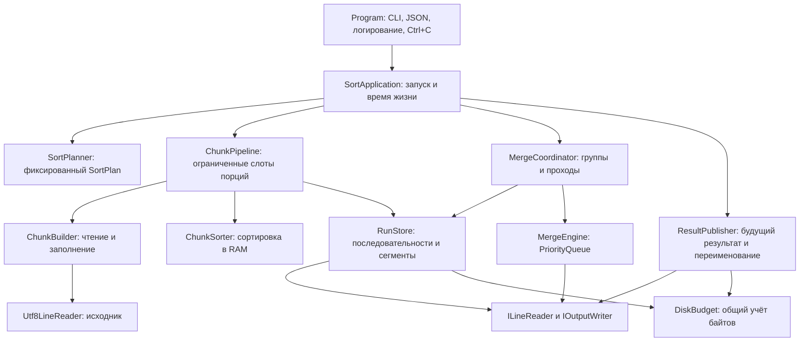

# LargeFileSort

Консольный генератор файлов формата `Number. String` для проверки внешней сортировки. Целевая платформа — .NET 10. Ниже описана работающая утилита генерации; [архитектура Sorter](#архитектура-largefilesortsorter) — проект следующей утилиты, её реализация ещё не готова.

Компоненты соединены в рабочий CLI: конфигурация, логирование, MemoryPhraseSource, OutputWriter и Generator. Код 0 означает успешное завершение команды; для генерации требуется подтверждённый повтор и закрытый файл. Пройдены [56 сквозных сценариев воспроизводимости и ошибок](docs/validation-2026-11-16.md), включая OOM при загрузке словаря. Сохранён отдельный [отчёт первого прогона](docs/first-run.md) на прежней версии словаря. Замеры производительности не проводились. Состав работ находится в [tasks/README.md](tasks/README.md), распределение ответственностей — в [docs/architecture.md](docs/architecture.md).

## Сборка

Для диагностического прогона CPU/аллокаций/GC подготовлен [scripts/Profile-Generator.ps1](scripts/Profile-Generator.ps1); запуск и состав файлов описаны в [инструкции профилирования](docs/profiling.md). Первый профиль разобран: [отчёт](docs/profile-report-2026-11-16.md).

Проверен вариант с дополнительным буфером OutputWriter и разобран [повторный профиль](docs/profile-buffered-writer-2026-11-16.md). Устойчивый выигрыш не установлен, код усложнился; по решению пользователя изменение отменено. Используется исходная реализация со StreamWriter. Этап профилирования завершён: явных проблем, требующих исправления сейчас, не выявлено; дальнейшие оптимизации не планируются в рамках этого этапа.

```powershell
dotnet build LargeFileSort.slnx
```

Прямые зависимости: `System.CommandLine` 3.0.0, `Microsoft.Extensions.Configuration.Json` 10.0.15 и `Microsoft.Extensions.Logging.Console` 10.0.15. Последний пакет также подключает `Microsoft.Extensions.Logging`, настройки логирования и необходимые транзитивные зависимости. Generic Host не используется; зависимости приложения собираются вручную.

## Конфигурация

`LargeFileSort.Generator/appsettings.example.json` содержит все используемые настройки приложения. Рабочие значения для `appsettings.json` задаются отдельно; приложение этот файл не создаёт и не перезаписывает. Значение 10 000 000 в примере — только пример, не автоматический лимит приложения.

Рабочий `appsettings.json` настроен: `MaxDictionaryBytes` = 1 000 000, `WriterBufferCharacters` = 65 536, `Logging.LogLevel.Default` = Information. Текущий словарь `data/phrases.txt` занимает 93 852 байта и содержит 2 157 нормализованных фраз. Справка не требует конфигурации.

```json
{
  "MaxDictionaryBytes": 10000000,
  "WriterBufferCharacters": 65536,
  "Logging": {
    "LogLevel": {
      "Default": "Information"
    }
  }
}
```

`MaxDictionaryBytes` обязателен: положительное целое число байтов в диапазоне `Int64`. `WriterBufferCharacters` — положительное целое число символов в диапазоне `Int32`; при отсутствии поля используется 65 536. Явный `null`, пустое или некорректное значение ошибочны.

При сборке и публикации пользовательский `appsettings.json` копируется рядом с приложением. Стандартный `ConfigurationBuilder` ищет его относительно `AppContext.BaseDirectory`; базовый каталог не переопределяется. Конфигурация загружается один раз, без слежения за изменениями. Отсутствие файла, повреждённый JSON и неверные значения приводят к сообщению в stderr и ненулевому коду завершения.

## Запуск и параметры

```powershell
dotnet run --project LargeFileSort.Generator -- --help
dotnet run --project LargeFileSort.Generator -- --dictionary phrases.txt --output result.txt --max-bytes 10000000000 --seed 42
```

| Параметр | Значение |
| --- | --- |
| `--dictionary` | Обязательный путь к словарю |
| `--output` | Обязательный путь к новому результату |
| `--max-bytes` | Обязательное положительное число байтов, `Int64` |
| `--seed` | Необязательный `Int32`, от −2 147 483 648 до 2 147 483 647 |
| `--help` | Справка без чтения конфигурации |

10 ГБ в контрольном сценарии — 10 000 000 000 байт. Значения с единицами вроде `10GB` не принимаются. Пути с пробелами заключайте в кавычки.

Относительные пути словаря и результата разрешаются от текущего рабочего каталога через `AppInfo.CurrentDirectory`, который обращается к `Directory.GetCurrentDirectory()`. Этот каталог может отличаться от каталога конфигурации. Пути приводятся к полному виду; одинаковые пути и существующий выходной файл или каталог отвергаются. Сравнение путей на Windows не учитывает регистр. При открытии OutputWriter дополнительно применяет CreateNew, поэтому предварительная проверка не является единственной защитой от перезаписи.

Справка работает и при отсутствующем или повреждённом `appsettings.json`. Встроенная поддержка дополнения `System.CommandLine` сохраняется; `dotnet-suggest`, регистрация приложения и настройка профиля оболочки не выполняются, поэтому Tab-дополнение в ненастроенной оболочке не обещается.

## Логирование

Используется `ILogger<T>` и стандартный консольный провайдер Microsoft. `LoggerFactory` создаётся в `Program.cs`; собственная абстракция логгера не вводится. При появлении конкретных компонентов их логгеры передаются через конструкторы.

Справка и пользовательский результат (выбранный seed и итоговые показатели) направляются в stdout. Все диагностические логи, включая Information и Debug, направляются в stderr.

По умолчанию включён уровень Information. Сообщение содержит локальное время `HH:mm:ss`, уровень, категорию и текст, без цветовых управляющих последовательностей. Используется простой однострочный формат консольного провайдера. Information обозначает начало и завершение этапов, Debug содержит параметры и подробности диагностики, Warning — нефатальные проблемы, Error — ошибку выполнения. Построчного логирования генерации нет.

Для изменения фильтрации измените секцию `Logging` в `appsettings.json`, например для более тихого вывода:

```json
"Logging": {
  "LogLevel": {
    "Default": "Warning"
  }
}
```

Поддерживаются стандартные фильтры по категориям. Параметры генератора и логирования читаются из одного экземпляра конфигурации. Конфигурация существует до завершения приложения; сначала освобождается фабрика логгеров, затем конфигурация. Приложение не изменяет файл конфигурации. В примере явно заданы лимит словаря, размер буфера и уровень логирования. Однострочный формат, время, отсутствие цветов и направление всех логов в stderr заданы в коде.

Ошибки CLI и конфигурации до создания логгера выводятся напрямую в stderr. После настройки логгера ошибка регистрируется один раз на уровне Error с исключением. Если Error отфильтрован, включая `LogLevel.None`, обязательное краткое сообщение всё равно выводится напрямую в stderr. При ошибке логирования исходная ошибка сохраняется, а проблема логирования сообщается отдельно.

При OOM выводится только краткое сообщение `Not enough memory.` без обращения к логгеру и без сложной очистки. При обычном завершении консольный провайдер освобождается после отправки сообщений. Ошибки освобождения сообщаются отдельно и приводят к ненулевому коду завершения.

## Модели и источник фраз

`CommandLineOptions` и `GeneratorConfiguration` представляют проверенные параметры. В CLI отсутствие seed обозначается `null`; приложение один раз выбирает значение и передаёт его в `GenerationOptions`. `GenerationResult` возвращает seed и подтверждённые 64-битные счётчики строк и байтов только после успешного завершения записи. Время измеряется отдельно приложением.

Лимиты файлов задаются в байтах; размер буфера StreamWriter — в символах, по умолчанию 65 536.

`IPhraseSource` предоставляет нормализованные непустые фразы по индексам от нуля. Дубликаты сохраняются и учитываются в `Count`, поэтому одинаковый текст может занимать несколько индексов.

### Загрузка словаря в память

`MemoryPhraseSource` реализует `IPhraseSource`. Конструктор принимает путь, положительный лимит файла в байтах и `ILogger<MemoryPhraseSource>`. Размер проверяется по открытому файлу до чтения содержимого; равенство лимиту допускается. Файл открывается только для чтения с `FileShare.Read` и закрывается после загрузки или ошибки.

Формат словаря — UTF-8, одна фраза на строку. Допускаются UTF-8 BOM, LF, CRLF и отсутствие последнего перевода строки. Расширение `.csv` не включает разбор колонок, экранирования или многострочных полей. UTF-8 BOM пропускается явно, автоматического переключения на UTF-16/UTF-32 нет. Некорректные UTF-8-последовательности вызывают ошибку декодирования.

Каждая строка обрабатывается через `Trim`; пустые после обработки строки пропускаются. Внутренние пробелы, порядок и дубликаты сохраняются. Пустой итоговый словарь и превышение лимита вызывают `InvalidDataException`. Фразы хранятся в закрытом `List<string>` без дополнительного копирования в массив, дедупликации или собственного кеша.

Лимит относится к исходному файлу, а не к фактической памяти: строки UTF-16, коллекция и временные данные могут занимать существенно больше места. Проверка доступной памяти не выполняется. `OutOfMemoryException` не перехватывается и не оборачивается источником, а передаётся верхнему обработчику приложения. Источник сообщает о начале и завершении загрузки и числе фраз; ошибки повторно не логирует.

## Запись и буферизация

В актуальной схеме генератор передаёт строки последовательно через `IOutputWriter.WriteLineAsync(prefix, phrase)` с `await`. Prefix содержит число и `. `; приёмник добавляет LF. Память prefix и phrase принадлежит вызывающему коду и не изменяется до завершения вызова. После этого её можно переиспользовать.

Собственных пакетов генератора, дополнительного накопительного буфера, очереди и настройки BatchCharacters нет. OutputWriter передаёт префикс через StreamWriter.WriteAsync, затем фразу и LF через StreamWriter.WriteLineAsync. Буферизацией управляет StreamWriter с существующей настройкой WriterBufferCharacters и AutoFlush = false. Данные, помещающиеся в буфер, могут приниматься синхронно; при заполнении выполняется асинхронный I/O. Await на строке не обязательно означает переключение потока или отдельную запись на диск.

### Реализация OutputWriter

`OutputWriter` — internal-реализация публичного `IOutputWriter`. Конструктор принимает путь, максимальный размер результата, размер буфера в символах, `ILogger<OutputWriter>` и функцию получения свободного места. В приложении используется `AppInfo.GetAvailableFreeSpace`.

Файл создаётся через `FileMode.CreateNew`, FileStream открыт для асинхронного I/O. StreamWriter использует строгий UTF-8 без BOM и LF. Новых NuGet-зависимостей нет. Размер внутреннего буфера задаётся конфигурацией; сам .NET применяет минимум 128 символов.

`WriteLineAsync` принимает строку, но она может оставаться в буфере. `FlushAsync` сбрасывает ранее принятые данные без закрытия и служит точкой подтверждения записи. Это не принудительная физическая синхронизация накопителя. `CompleteAsync` завершает кодирование, сбрасывает данные и закрывает файл. Только после его успеха можно объявлять успех генерации.

Повторное завершение после успеха и последующее освобождение безопасны. `DisposeAsync` без CompleteAsync освобождает ресурсы, но не подтверждает успех генерации. После ошибки записи или FlushAsync новые записи и успешное завершение запрещены; при освобождении не предпринимается повторное кодирование испорченного буфера.

Файловый поток закрывается отдельно от сброса StreamWriter. Единственная ошибка передаётся без оборачивания; одновременные ошибки сброса и закрытия передаются в AggregateException, начиная с исходной. Обычная ошибка инициализации после создания файла приводит к закрытию и удалению именно созданного файла; ошибки очистки также сохраняются. После OOM гарантированная очистка не требуется. После успешного создания приёмника удаление неполного результата организует приложение в задаче 06.

### Свободное место

До создания результата выполняется один запрос свободного места на томе каталога результата. Требуется не меньше `--max-bytes`: равенство допускается, дополнительного запаса и резервирования нет. При известном недостатке места файл не создаётся.

Если сведения получить не удалось, логируется Warning и выполняется попытка записи. OOM не трактуется как обычный отказ проверки. Место может закончиться позже, поэтому ошибки записи, сброса и закрытия передаются вызывающему коду.

`AppInfo` на Windows вызывает GetDiskFreeSpaceExW для конкретного каталога, учитывая доступное пользователю место, точки подключения и UNC-пути. На остальных платформах используется DriveInfo для каталога. Отсутствующие родительские каталоги приёмник не создаёт.

## Генерация и контроль размера

`Generator` получает IPhraseSource, IOutputWriter, GenerationOptions и ILogger через конструктор. GenerationOptions содержит обязательный int seed и положительный 64-битный лимит. GenerateAsync вызывается без параметров; реализация не выбирает seed и не знает о его отсутствии в CLI. Генератор не владеет временем жизни writer: вызывает CompleteAsync, а DisposeAsync обеспечивает приложение.

Числа выбираются из `[0, Int32.MaxValue)`, форматируются независимо от культуры, без ведущих нулей и разделителей разрядов. Prefix формируется в переиспользуемом массиве из 12 символов. Фраза передаётся из словаря без дополнительной копии полной строки.

До передачи строки вычисляется полный размер в UTF-8: число, `. `, фраза и LF. Проверка использует оставшийся объём `maxBytes - acceptedBytes`. На первой непомещающейся строке генерация заканчивается: другие фразы не выбираются, текст не обрезается, остаток не заполняется. Если первая строка не помещается, возникает ошибка.

Счётчики принятых строк и байтов — Int64. В процессе данные могут быть буферизованы; итоговый GenerationResult возвращается только после успешного CompleteAsync, когда весь принятый объём подтверждён.

### UTF-16 и длинные фразы

Длинная фраза не требует отдельного массива размером со строку: StreamWriter обрабатывает переданный ReadOnlyMemory через собственные буферы и сохраняет состояние кодировщика, включая UTF-16 surrogate pairs на внутренних границах. Явный FlushAsync генератора выполняется после полной строки с LF.

Для подсчёта UTF-8-байтов генератор обходит фразу фрагментами span, не разрывая суррогатную пару. Общая сумма 64-битная; дополнительные символьные массивы и кеш размеров фраз не создаются. Не предусмотренные источником некорректные суррогаты приводят к ошибке кодирования.

## Seed и воспроизводимость

Для фраз используется `new Random(inputSeed)`. Для чисел — `new Random(numberSeed)`, где numberSeed вычисляется фиксированным [fmix32 из MurmurHash3](https://github.com/aappleby/smhasher/blob/master/src/MurmurHash3.cpp#L63): XOR со сдвигами 16, 13, 16 и умножения на `0x85ebca6b` и `0xc2b2ae35` в unchecked-арифметике UInt32.

Результат преобразуется в int. Защита исключает совпадение seed, в том числе эквивалентные для Random значения противоположных знаков: сравниваются абсолютные значения с нормализацией Int32.MinValue в Int32.MaxValue. При совпадении seed чисел становится 1 для нормализованного нуля, иначе 0. Поэтому хеш нуля не приводит к двум генераторам с одинаковым seed.

GetHashCode, вспомогательный Random и дополнительные пакеты для вычисления numberSeed не используются. Одинаковые нормализованный словарь, входной seed, параметры и реализация дают побайтово одинаковый результат, включая числа. Между разными версиями .NET воспроизводимость стандартного Random не обещается.

Если seed не передан, Program.cs один раз выбирает его через `new Random().Next()` для текущего запуска и выводит до загрузки словаря и генерации. Затем обязательное значение передаётся в конструктор Generator через GenerationOptions. Автоматически выбранный seed можно передать в следующий запуск для воспроизведения результата. Ноль является допустимым явным seed, а не признаком отсутствия значения.

## Завершение приложения и диагностика

Загрузка словаря измеряется отдельно через Stopwatch. Время генерации включает GenerateAsync, CompleteAsync и освобождение writer. После закрытия файла фактическая длина сверяется с ByteCount генератора.

При успехе stdout содержит выбранный seed, число строк, фактические байты, время загрузки и генерации в секундах с тремя знаками после точки, среднюю скорость в МБ/с (1 МБ = 1 000 000 байт). Числовое форматирование независимо от культуры. Итоговые показатели выводятся после успешного завершения и освобождения ресурсов.

При обычной ошибке приложение пытается закрыть writer, затем удалить незавершённый результат, только если успешно создало его само. Ошибка удаления или освобождения сообщается отдельно и приводит к ненулевому коду, не скрывая исходную диагностику. Уже существовавший результат не удаляется. Полностью завершённый и проверенный файл не удаляется при последующей ошибке вывода диагностики. После OOM сложная очистка и гарантированное удаление не выполняются.

## Сброс и подтверждение повтора

Порог сброса — `maxBytes / 3 + (maxBytes % 3 == 0 ? 0 : 1)`, то есть округлённая вверх треть без переполнения. После приёма первой строки, достигшей или пересёкшей порог, генератор вызывает FlushAsync. Только после его успеха пересоздаёт Random фраз с inputSeed. Random чисел продолжает последовательность.

Следующая выбранная фраза совпадает с первой. После приёма этой полной строки выполняется второй FlushAsync. Его успешное завершение устанавливает флаг повтора. Сам сброс и помещение данных в буфер повтор не подтверждают. Сравнение текстов, HashSet и поиск случайных дубликатов не выполняются.

При успешной генерации явных FlushAsync ровно два; построчного Flush нет. Если строка после сброса не помещается либо её запись/Flush завершается ошибкой, успех не объявляется. После подтверждения повтора остальные строки буферизуются обычным образом до CompleteAsync.

## Возможная очередь

Channel сейчас отсутствует. Будущий приёмник может реализовать ограниченную очередь за тем же контрактом: WriteLineAsync должен ждать свободного места и обеспечить независимое владение данными до разрешения переиспользовать память вызывающему коду. FlushAsync обязан дождаться записи всех ранее принятых строк, CompleteAsync — окончания очереди и закрытия потока. Ошибки потребителя должны доходить до производителя без зависания. Необходимость конвейера определяется позднее замерами.

## Архитектура LargeFileSort.Sorter

Архитектура подготовлена в задаче 01 от 2026-11-17. В задаче 02 создан скелет с моделями и I/O-контрактами, в 03 подключены CLI, конфигурация и логирование, в 04 реализованы чтение, разбор и сравнение, в 05 — планирование RAM, формирование и сортировка порции, в 06 — хранилище последовательностей, дисковый бюджет и публикация результата. Компоненты обработки ещё не подключены к CLI; конвейер, слияние и сортировка файла целиком не реализованы. [Архитектурная задача](tasks/sorter-01-architecture.md) содержит границы работы и соответствие разделам ТЗ; [индекс задач Sorter](tasks/sorter-README.md) — согласованный порядок реализации и статусы.

### Реализованный скелет Sorter

Проект LargeFileSort.Sorter включён в LargeFileSort.slnx. TargetFramework — net10.0; ImplicitUsings и Nullable сохранены в disable по указанию пользователя. Все using задаются явно. В задаче 03 подключены System.CommandLine 3.0.0, Microsoft.Extensions.Configuration.Json 10.0.15 и Microsoft.Extensions.Logging.Console 10.0.15 — те же версии, что у генератора.

В Abstractions находятся публичные ILineReader и IOutputWriter. В Models — SortRecord, SortChunk, SortedRun, RunSegment, SortPlan, CommandLineOptions, SorterConfiguration, PendingRecord, ChunkReadResult, ChunkPipelineResult, SortStatistics и SortResult. Все модели internal; записи и вспомогательные значения — readonly struct, параметры и результаты — неизменяемые record, SortChunk и рабочая статистика — изменяемые классы. Чтение и разбор находятся в Reading, общий компаратор — в Comparison, расчёты — в Planning, формирование и сортировка порций — в Chunks.

SortPlan разделяет WorkerCount и ChunkSlotCount: число обработчиков не обязано совпадать с числом удерживаемых порций, включая заполняемую. ChunkReadResult возвращает признаки EOF/переноса, PendingRecord сохраняет исходный номер переноса. ChunkPipelineResult различает завершённую прямую запись и каталог run; OutputCompleted означает закрытие выхода, а не публикацию целевого файла. SortResult содержит итоговый снимок счётчиков, времён и пиков; измерение резидентной памяти может быть недоступно и имеет тип long?.

После проверки аргументов, путей и конфигурации Program пока выводит `Sorter is not implemented yet.` в stderr и возвращает код 1; файлы данных не создаёт. Рабочий алгоритм подключается в последующих задачах. Справка уже доступна и завершается кодом 0.

### CLI и конфигурация Sorter: текущий этап

```powershell
dotnet run --project LargeFileSort.Sorter -- --help
dotnet run --project LargeFileSort.Sorter -- --input source.txt --output result.txt --temp-directory temporary
```

Все три пути обязательны, значения с пробелами заключаются в кавычки. Исходник должен существовать как файл; родитель результата и временный каталог должны существовать как каталоги. Относительные пути приводятся к абсолютным от текущего рабочего каталога. Источник и результат должны различаться, существующий выходной файл или каталог отвергается. Проверка путей пока предварительная: CreateNew и публикация без перезаписи появятся с хранилищем. Приложение на этом этапе не читает формат записей и не создаёт каталог запуска или результат.

Конфигурация ищется стандартным ConfigurationBuilder относительно AppContext.BaseDirectory, загружается один раз без слежения за изменениями. Рабочий appsettings.json копируется при сборке и публикации рядом с приложением. --help не загружает JSON и логирование, работает даже при отсутствующем/повреждённом JSON. Неизвестные параметры CLI, включая попытку переопределить RAM/параллелизм, отклоняются.

Все шесть настроек сортировки обязательны. Для целочисленного разбора используется InvariantCulture; отсутствие, null, пустое/нечисловое значение, дробь, объект/массив и переполнение ошибочны. Настройки задаются без суффиксов единиц вроде MB. Проверка пригодности RAM относительно буферов и выбор фактического параллелизма относятся к SortPlanner в задаче 05; отдельное допустимое число пока не означает пригодный план.

| Ключ | Диапазон и единицы | Согласованное рабочее значение |
| --- | --- | --- |
| MemoryBudgetBytes | Положительный Int64, байты | 268 435 456 (256 МиБ) |
| MaxParallelism | Положительный Int32 | 4 |
| MaxMergeSources | Int32 от 2 | 16 |
| ExtraDiskSpace | Целое от 1 до 10 | 1 (10%) |
| ReaderBufferBytes | Положительный Int32, байты | 65 536 |
| WriterBufferCharacters | Положительный Int32, символы | 65 536 |

[appsettings.example.json](LargeFileSort.Sorter/appsettings.example.json) содержит все используемые настройки, включая Logging. Рабочий appsettings.json создан с подтверждёнными пользователем значениями; приложение его не создаёт и не перезаписывает. Это начальные значения для проверок, не измеренные defaults и не автоматические значения при отсутствии полей.

```json
{
  "MemoryBudgetBytes": 268435456,
  "MaxParallelism": 4,
  "MaxMergeSources": 16,
  "ExtraDiskSpace": 1,
  "ReaderBufferBytes": 65536,
  "WriterBufferCharacters": 65536,
  "Logging": {
    "LogLevel": {
      "Default": "Information"
    }
  }
}
```

Логирование настроено как у генератора: ILogger<T>, ручное создание фабрики, Information по умолчанию, стандартные фильтры Logging, однострочный формат с локальным временем HH:mm:ss, без цветов. Все уровни логов направляются в stderr, справка — в stdout. Debug содержит нормализованные пути и значения настроек, Information сообщает о загрузке конфигурации. Сообщение о неготовом алгоритме выводится независимо от фильтров, в том числе при Logging.LogLevel.Default=None. Ошибки до логгера доступны напрямую в stderr; ошибки логирования/освобождения не скрывают исходную причину. OOM даёт краткое `Not enough memory.` и ненулевой код без сложной очистки. Фабрика логгеров освобождается перед конфигурацией.

Проверены сборка solution без предупреждений/ошибок и 106 сквозных сценариев на Windows. Воспроизведение в PowerShell 7: [scripts/Validate-SorterCli.ps1](scripts/Validate-SorterCli.ps1), после сборки выполнить `./scripts/Validate-SorterCli.ps1`. Скрипт использует отдельную копию приложения внутри artifacts, проверяет неизменность конфигурации/исходника/существующей цели и отсутствие результата/временных данных; успешные временные данные проверки удаляет, при ошибке сохраняет для разбора. Тестового проекта и нагрузочных прогонов нет. Проверки отражают текущий этап с кодом 1 на корректном вызове; при подключении рабочего алгоритма эти ожидания нужно обновить.

### Реализованные компоненты чтения и сравнения Sorter

[Utf8LineReader](LargeFileSort.Sorter/Reading/Utf8LineReader.cs) получает открытый Stream, имя источника для ошибок, размер byte-буфера и allowUtf8Bom (по умолчанию true). Поток должен поддерживать чтение/позиционирование и находиться на позиции 0. После успешного конструктора reader владеет потоком; при отказе конструктора поток остаётся у вызывающего кода. Конструктор не выполняет чтение и не выделяет полный буфер StreamReader. При первом ReadLineAsync выполняются асинхронная проверка первых трёх байтов и создание стандартного StreamReader со строгим UTF-8, без определения других кодировок. При allowUtf8Bom=false начальный BOM остаётся в данных: этот режим предназначен для временных run, в которых BOM не допускается форматом.

Reader возвращает все строки, включая пустые/пробельные, без разделителей. LineNumber изначально 0, после каждой возвращённой строки увеличивается на 1, на EOF не меняется. Повторный EOF возвращает null. Снятие BOM касается только одного BOM в начале; BOM внутри данных не удаляется. Длинные строки обрабатываются стандартным reader без собственного ограничения длины; OOM при чрезмерной строке возможен по условиям ТЗ.

Отмена проверяется и перед чтением уже буферизованной строки. После ошибки/отмены reader запрещает продолжение, DisposeAsync закрывает инициализированный StreamReader и переданный поток, в том числе если чтение ещё не начиналось. Освобождение повторно безопасно; ошибка закрытия потока передаётся вызывающему коду. Ошибка UTF-8 содержит имя источника и исходный DecoderFallbackException как InnerException, без обещания точного номера повреждённой строки. Обычная I/O-ошибка и отмена передаются без подмены EOF.

[RecordParser](LargeFileSort.Sorter/Reading/RecordParser.cs) синхронно возвращает SortRecord с исходной string, числом и смещением текста. Находит первое `. `, проверяет ASCII-цифры и диапазон одним проходом префикса с защитой переполнения, принимает ведущие нули любой длины, проверяет текст через char.IsWhiteSpace. Корректный путь не создаёт подстрок. Ошибка формата/числа/текста — InvalidDataException с источником, номером и причиной; вся некорректная строка в сообщение не копируется. Parser не пропускает пробельные строки: это ответственность будущего ChunkBuilder, который также добавит предупреждения.

[SortRecordComparer](LargeFileSort.Sorter/Comparison/SortRecordComparer.cs) сравнивает текстовые span через OrdinalIgnoreCase, затем числа через CompareTo; ключи не пересоздаёт. Он предназначен для сортировки только заполненной части массива и очереди слияния с уже разобранными записями. Пустые элементы ёмкости массива и default(SortRecord) не являются валидными записями для сравнения.

StreamReader буферизует чтение; вызов ReadLineAsync не означает отдельное обращение к потоку/диску или переключение потока исполнения на каждой строке. Тем не менее создание string, накопление пересекающей буфер строки и асинхронная обвязка имеют стоимость. ValueTask-контракт не гарантирует отсутствие внутренних Task-аллокаций. Текущая реализация использует ReadLineAsync как исходный вариант, преимущество над ReadLine не заявляется; сравнение режимов I/O остаётся задачей замеров. Физические запросы накопителя также зависят от FileStream и кеша ОС.

Проверка компонентов: `./scripts/Validate-SorterReading.ps1` в PowerShell 7 с .NET 10. [Сценарии](scripts/Validate-SorterReading.cs) компилируются вместе с теми же исходниками компонентов во временный executable внутри artifacts, без добавления тестового проекта в solution, пакетов, изменения видимости или InternalsVisibleTo. Успешные временные данные удаляются; при ошибке сохраняются, -KeepArtifacts оставляет их и после успеха.

На Windows прошли 114 проверок: формат/числа/Unicode, три культуры сравнения, независимый эталон и точное мультимножество 1000 записей с seed 42, BOM/разделители/EOF, границы UTF-8/CRLF/буфера, короткие чтения по 1–3 байта, строка более 100000 символов, повреждённые кодировки, отмена до/во время чтения и при готовой строке в буфере, I/O-ошибки, владение и закрытие. На прогретом корректном пути 10000 операций parser/comparer не выделяли managed-память. Для 1000 коротких строк проверено ограниченное число ReadAsync нижнего потока; это не измерение физических запросов к накопителю. Также проверен настоящий асинхронный FileStream с BufferSize=1, сохранение байтов исходника и освобождение файлового дескриптора. Сравнительных замеров скорости и OOM-инъекций не было.

### Реализованные планирование и обработка порции Sorter

[MemoryEstimator](LargeFileSort.Sorter/Planning/MemoryEstimator.cs) и [SortPlanner](LargeFileSort.Sorter/Planning/SortPlanner.cs) — статические расчёты. Create получает конфигурацию, длину открытого исходника и доступное число процессоров. Рабочие массивы, потоки и задачи при этом не создаются. План фиксирует W работников, W+1 слотов порций, Q на порцию, резервы чтения/буферов/управления/каталога и область слияния, предел источников и MaxRunCount. Также вычисляет дисковый потолок и начальную цель сегмента; фактический дисковый контроль реализован в хранилище 06.

W ограничивается конфигурацией, CPU и двумя условиями RAM: первой фазой с пригодным Q и возможностью двухпутевого слияния двух максимально допустимых строк. Верхние границы W вычисляются напрямую из этих неравенств, без перебора потенциально огромного числа работников. Минимальный Q — максимум 1 МиБ и четырёх оценок пары reader/writer. Для выбранного W берётся меньший Q из двух фаз с округлением вниз до 8 байтов. Это начальная консервативная политика, не результат измерения оптимального числа работников.

[SortChunk](LargeFileSort.Sorter/Models/SortChunk.cs) получает положительный budgetBytes. Изначально массив пуст. TryAdd оценивает строку и ёмкость, при росте учитывает одновременно старый и новый массивы вместе со строками. Целевая ёмкость растёт геометрически, но ограничивается доступным пиком; при отказе состояние порции не меняется. Count, EstimatedMemoryBytes и PeakEstimatedMemoryBytes изменяются только внутри порции. Records доступен сортировщику, но заполненная часть не должна произвольно изменяться другими участниками. Release снимает ссылку на весь массив и строки и обнуляет учёт; бюджет сохраняется, порцию можно использовать снова. Пул массивов и предварительное выделение полного Q не добавлялись.

[ChunkBuilder](LargeFileSort.Sorter/Chunks/ChunkBuilder.cs) — единственный последовательный производитель. Через конструктор получает ILineReader, имя источника, SortStatistics и ILogger. FillAsync требует пустую порцию, читает до EOF или невозможности добавить следующую валидную запись. Полностью пробельные строки пропускает с отдельным Warning и исходным номером; RecordParser.Parse вызывает статически. Сохраняет одну уже разобранную PendingRecord с исходным номером и переносит её в следующую порцию без повторного чтения/разбора/счёта. Проверка размера пустой порции включает минимальный массив одной записи; превышение даёт источник, номер, требуемые и разрешённые расчётные байты.

Builder читает хвост пропусков даже после заполнения порции: если следующей валидной записи нет, возвращает EOF без лишнего run. При повторном запросе после EOF не читает источник и не увеличивает число порций. Статистика включает физические прочитанные/пропущенные строки и непустые завершённые порции; выходные записи и байты здесь не считаются. После ошибки или отмены builder запрещает продолжение и снимает ссылку на перенос. Сам reader не закрывает — им владеет вызывающий код. Глобальный RAM-пик конвейера и объединение метрик будут подключены в 07/09; текущий пик SortChunk локален и доступен до Release.

[ChunkSorter](LargeFileSort.Sorter/Chunks/ChunkSorter.cs) получает общий comparer через конструктор и синхронно вызывает Array.Sort на диапазоне [0, Count). Массив и текстовые части не копируются. Токен проверяется до и после сортировки; прерывание внутри Array.Sort не обещается. Запуск CPU-задач относится к конвейеру 07, а не к этому компоненту.

Проверка: после Debug-сборки выполнить `./scripts/Validate-SorterChunks.ps1` в PowerShell 7. [Сценарии](scripts/Validate-SorterChunks.cs) используют те же исходники и уже установленную Microsoft.Extensions.Logging.Abstractions.dll во временном executable внутри artifacts; новые пакеты и тестовый проект в solution не добавляются. Прошли 78 сценариев: независимые неравенства RAM обеих фаз, CPU/config-ограничения, размеры вплоть до Int64, переполнение дискового потолка, ёмкость/рост/освобождение, перенос, предупреждения, EOF, ошибки/отмена и сортировка с независимым эталоном и точными кратностями. Пройден также сценарий чтения из 04 — 114 проверок после перехода на статический parser. Нагрузочных прогонов и выбора новых defaults не было; CLI сохраняет поведение 03.

### Реализованное хранилище Sorter

[DiskBudget](LargeFileSort.Sorter/Storage/DiskBudget.cs) получает рассчитанный потолок и предел одновременно открытых писателей, равный W из плана. Перед записью атомарно резервируется полный размер строки в UTF-8 с LF. Резерв включает данные в буфере; при нехватке возникает IOException до передачи строки StreamWriter. PeakReservedBytes фиксирует максимум резервов, PeakActualBytes — отдельно измеренный максимум логических длин. CaptureActualPeak вызывается в согласованных точках без одновременной записи: перед удалением сегмента, после завершения всех писателей первой фазы и перед публикацией. Реестр содержит только ограниченное число открытых потоков; длины закрытых файлов суммируются без списка всех сегментов.

[Utf8OutputWriter](LargeFileSort.Sorter/Storage/Utf8OutputWriter.cs) использует стандартный StreamWriter со строгим UTF-8 без BOM и LF. FileStream открывается с Asynchronous/SequentialScan и BufferSize=1; буферизация остаётся у StreamWriter/StreamReader. Размер UTF-8 считается один раз на строку с 64-битной суммой. CompleteAsync сбрасывает кодировщик и буфер, проверяет фактическую длину и закрывает поток; лишь затем доступен успешный статус. DisposeAsync закрывает поток без подтверждения и без повторной записи оставшегося буфера. После ошибки или отмены продолжение запрещено, резерв сохраняется до удаления. Ошибки сброса и закрытия возвращаются вместе с исходной причиной.

[RunStore](LargeFileSort.Sorter/Storage/RunStore.cs) создаёт собственный каталог запуска внутри существующего временного каталога. CreateWriter ограничен W, OpenReader — MaxMergeSources; повторное открытие одного run одновременно запрещено. Писатель и reader принадлежат вызывающему коду и должны быть освобождены до DisposeAsync хранилища. Само хранилище владеет файлами, именуемыми по run-id и индексу сегмента; отдельного массива путей нет. Вспомогательный StorageAccount хранит только суммы резервов и закрытых файлов своего владельца, позволяя очистить и неполные записи без каталога всех файлов в RAM.

[SegmentedRunWriter](LargeFileSort.Sorter/Storage/SegmentedRunWriter.cs) получает цель сегмента из SortPlan для текущей фазы. Перед превышением цели закрывает непустой сегмент; отдельная строка не режется. Строка больше цели образует собственный сегмент при достаточной общей квоте, нулевая цель означает один сегмент на строку. Пустой run не создаёт файлов. GetCompletedRun доступен только после успешного CompleteAsync: дескриптор содержит фактические числа строк/сегментов, сумму байтов и максимумы строки/записи/сегмента. До этого неполные файлы остаются собственностью RunStore.

[SortedRunReader](LargeFileSort.Sorter/Storage/SortedRunReader.cs) реализует ILineReader, открывает только текущий сегмент и ведёт общий LineNumber последовательности. После EOF закрывает сегмент, снимает пик, удаляет файл и лишь затем освобождает квоту и переходит дальше. Ранний Dispose закрывает reader, оставляя непрочитанные файлы хранилищу. Ошибка открытия, чтения, удаления, неверная итоговая длина или число строк приводят к ошибке, после которой чтение не возобновляется. Временные последовательности потребляются однократно.

[ResultPublisher](LargeFileSort.Sorter/Storage/ResultPublisher.cs) при CreateWriter лениво создаёт собственный файл через CreateNew рядом с целью. Publish разрешён после успешного CompleteAsync писателя и выполняет File.Move с overwrite:false без копирования. Поэтому появившаяся перед переименованием цель тоже защищена. Dispose удаляет непубликованный файл; опубликованный результат сохраняется и остаётся включённым в итоговый дисковый расход. Для обоих владельцев квота освобождается только после успешного удаления. Если очистка части файлов не удалась, учёт остаётся консервативным до успешной повторной очистки; RunStore сообщает число ошибок и первую причину, не накапливая неограниченный список исключений. Сбор исходной ошибки запуска и ошибок очистки подключается в 09.

Проверка: `./scripts/Validate-SorterStorage.ps1` в PowerShell 7. Локальные сценарии компилируют те же исходники во временный executable внутри artifacts, без новых пакетов и проекта в solution; scripts остаётся вне Git. На Windows/.NET 10 прошли 45 сценариев: конкурентная квота и Int64, UTF-8/Unicode/границы буфера/длинная строка, буферизованные резервы и фактические длины, частичная запись, ошибки flush/close/delete, отмена, обычные и сегментированные run, раннее удаление после закрытия, метаданные и ограничения открытых потоков, пустой результат и защита публикации. Отдельно проверены рост `0. a` с 4 до 5 байт и потоковая перезапись 1000 байт при лимите 1100 с точным сохранением 200 одинаковых записей. Конвейера и алгоритма слияния в этой проверке нет. Физический расход ФС не измеряется; сравнительных замеров I/O и выбора defaults не было.

### Требования и согласованные уточнения Sorter

Используем .NET 10 и те же библиотеки CLI, JSON-конфигурации и логирования, что у генератора; без Generic Host и IoC-контейнера. Код переносимый для Windows и Linux, проверки выполняются на доступной машине. Существующие компоненты генератора не перемещаем в общую библиотеку: у сортировщика другое владение файлами и бюджетами.

Через CLI передаются обязательные `--input`, `--output`, `--temp-directory`. RAM, максимальный параллелизм, максимальное число источников, дополнительное место и буферы задаются только в `appsettings.json`, без CLI-переопределений. Подтверждённые имена настроек: `MemoryBudgetBytes` (Int64, байты), `MaxParallelism` (Int32), `MaxMergeSources` (Int32, не меньше 2), `ExtraDiskSpace` (целое 1–10), `ReaderBufferBytes` (Int32, байты), `WriterBufferCharacters` (Int32, символы), секция `Logging`. Остальные числовые значения положительные; слишком маленький RAM-бюджет относительно буферов будет отвергаться планировщиком. Неявного уменьшения заданных буферов нет. Точные значения по умолчанию RAM, параллелизма и буферов выбираются только после замеров; до этого требуются явные значения для проверок. Неизвестные параметры CLI и некорректные значения конфигурации вызывают понятную ошибку.

`appsettings.example.json` включает все используемые настройки. Рабочий `appsettings.json` согласован отдельно; приложение не создаёт и не перезаписывает конфигурацию. Реализованы правила генератора: конфигурация рядом с приложением, относительные файловые пути от текущего каталога, справка без конфигурации. Итоговые показатели и справка идут в stdout, диагностика через `ILogger<T>` — в stderr; итоговые показатели сортировки пока не реализованы.

Разрешены UTF-8 BOM только в начале исходника, LF, CRLF и, по согласованному уточнению, одиночный CR. Пробельность определяется через `char.IsWhiteSpace`. Ведущие нули допустимы: число состоит только из ASCII-цифр `0`–`9`, его значение строго меньше `Int32.MaxValue`; запись не форматируется заново. Делитель — первое `. `, текст после него должен содержать непробельный символ. Строки не обрезаются и не нормализуются. Пустые и полностью пробельные строки пропускаются с Warning и исходным номером строки; другие некорректные строки прерывают запуск.

Исходник должен оставаться неизменным во время запуска. Проверяются нормализованные абсолютные пути; на Windows сравнение без учёта регистра, на Linux — с учётом регистра. Существующий выходной файл или каталог отвергается, проверка повторяется при публикации без перезаписи. Распознавание hard link, символьных ссылок и нестандартных правил регистра файловой системы не входит в гарантии. Исходник открывается только на чтение с `FileShare.Read`; это дополнительно запрещает совместную запись на Windows, но не заменяет условие неизменности на всех ОС.

### Модель и инварианты Sorter

| Тип | Содержимое и владелец |
| --- | --- |
| `SortRecord` | `readonly struct`: исходная `string`, `int Number`, `int TextOffset`. Принадлежит порции либо текущей позиции источника слияния. |
| `SortChunk` | Массив записей с фактическим Count, ёмкостью и расчётным расходом RAM. В каждый момент принадлежит производителю или одному обработчику порции. |
| `SortedRun` | Дескриптор завершённой последовательности: идентификатор, число сегментов, строк и UTF-8-байтов, максимальная длина строки в символах, максимальный размер записи в UTF-8 с LF и максимальный размер сегмента. Данные находятся на диске. |
| `RunSegment` | Описание одного текущего файла: идентификатор последовательности, номер сегмента и длина. Полный список сегментов в RAM не хранится. |
| `SortPlan` | Неизменяемые параметры запуска: RAM-резервы двух фаз, отдельно число работников и слотов порций, лимит порции, верхний предел источников слияния, дисковый потолок и начальный размер сегмента. Сам расчёт выполняет SortPlanner. |
| `SortStatistics` / `SortResult` | Рабочие счётчики и итоговый снимок после закрытия ресурсов и публикации. Это данные, не обработчики. |

Все перечисленные типы — `internal`. Дескриптор не является владельцем открытого потока; жизненный цикл временных файлов принадлежит `RunStore`. Основные I/O-интерфейсы публичные и передают стандартные типы, поэтому ради них не требуется делать модели публичными.

Главный инвариант: успешный результат содержит все валидные записи с той же кратностью повторений и сохранённой исходной строкой, кроме перевода строки. Следующая запись не меньше предыдущей по тексту `OrdinalIgnoreCase`, затем по числу. Полностью равные ключи могут менять взаимный порядок. Любая некорректная запись отменяет весь результат, а не исключается из него.

Сортировка порций и `PriorityQueue` используют один `SortRecordComparer : IComparer<SortRecord>`. Сравниваются `Line.AsSpan(TextOffset)` через `MemoryExtensions.CompareTo` с `StringComparison.OrdinalIgnoreCase`, затем числа через `CompareTo`, без вычитания, подстрок и изменения регистра строк. Номер разбирается при чтении каждой записи, не в компараторе. Временные файлы также текстовые: при повторном чтении в новом проходе число и смещение разбираются один раз заново. Дополнительные числовые заголовки в каждую временную запись не записываются, поскольку они увеличили бы расход диска.

В начале каждой итерации выбора минимума очередь содержит одну минимальную ещё не выданную запись каждого активного источника. После извлечения запись отправляется в приёмник, затем читается и добавляется следующая запись того же источника. До следующего извлечения инвариант восстановлен. Индекс источника находится в элементе очереди, приоритет — `SortRecord`; дополнительного критерия сортировки нет.

### Компоненты и направление зависимостей Sorter



| Компонент | Вход → выход | Зависимости и владение |
| --- | --- | --- |
| `Program` + конфигурация | Аргументы/JSON → проверенные настройки, код завершения | Создаёт логгеры, общий токен Ctrl+C и компоненты через конструкторы. Глобально обрабатывает OOM и ошибки вывода. |
| `SortPlanner` / `MemoryEstimator` | Настройки, длина исходника, CPU / размеры данных → план и оценки | Статические синхронные расчёты; файлов, рабочих массивов и фоновых задач не создают. |
| `Utf8LineReader` | Один открытый поток → исходные строки с номером | После успешного конструктора владеет переданным Stream и StreamReader. Строгий UTF-8 и однократное снятие BOM для исходника, отключаемое для run. |
| `RecordParser` | Строка и контекст ошибки → `SortRecord` | Статический синхронный разбор. `ChunkBuilder` сам отбрасывает пробельные строки; в run такие строки считаются повреждением. |
| `ChunkBuilder` | `ILineReader`, лимит → заполненная порция и признак EOF | Владеет только текущей порцией и одной переносимой записью с исходным номером. Не запускает работников и не пишет файлы. |
| `ChunkSorter` | `SortChunk` → та же отсортированная порция | Общий компаратор, сортировка только используемой части массива без копии через `ToArray`. |
| `ChunkPipeline` | Исходник → каталог `SortedRun` либо прямая запись одной порции | Владеет ограниченным набором задач и слотами порций; использует builder, sorter, store и конечный приёмник. |
| `RunStore` | Строки/дескриптор → завершённый run/его читатель | Владеет отдельным каталогом запуска и правилами имён, создаёт `SegmentedRunWriter` и `SortedRunReader`, удаляет сегменты. |
| `MergeEngine` | Список `ILineReader`, `IOutputWriter` → число выданных записей | Parser и общий компаратор. Не знает путей и сегментов, не освобождает переданные ему объекты. |
| `MergeCoordinator` | Каталог run → проходы и финальная запись | Выбирает группы по плану и дескрипторам, открывает и закрывает читателей/писателя, после успеха заменяет группу новым run. |
| `DiskBudget` | Размер предстоящей записи/успешно удалённого файла → резерв/освобождение и пики | Общий потокобезопасный счётчик, проверка до передачи данных писателю; ведёт также агрегат закрытых файлов и ограниченный реестр открытых писателей для снимков фактических длин. Не владеет файлами и не ждёт освобождения диска. |
| `ResultPublisher` | Целевой путь → приёмник будущего результата → публикация | Владеет только своим временным файлом рядом с целью; переименование без перезаписи после закрытия. |
| `SortApplication` | Проверенные параметры → `SortResult` | Координирует фазы, владельцев ресурсов и статистику; публикует результат после завершения необходимых операций. |

RecordParser.Parse, MemoryEstimator и SortPlanner используют статические операции без состояния. ChunkSorter, ChunkBuilder, координаторы, RunStore, DiskBudget и ResultPublisher — internal-компоненты с зависимостями через конструкторы. DI не требует интерфейса для каждого класса. Отдельные фабрики-фасады, общий репозиторий, Event Bus и собственный кеш не нужны.

### I/O-контракты Sorter

Ниже сигнатуры, заведённые в задаче 02. Пространство имён сортировщика отделяет его `IOutputWriter` от существующего интерфейса генератора; интерфейс генератора не меняется. При Nullable=disable EOF задаётся контрактом возврата null, без аннотации string?.

```csharp
public interface ILineReader : IAsyncDisposable
{
    long LineNumber { get; }
    ValueTask<string> ReadLineAsync(CancellationToken cancellationToken);
}

public interface IOutputWriter : IAsyncDisposable
{
    ValueTask WriteLineAsync(ReadOnlyMemory<char> line, CancellationToken cancellationToken);
    ValueTask CompleteAsync(CancellationToken cancellationToken);
}
```

Вызовы одного объекта последовательные, пересекающихся операций нет. Читатель возвращает строку без разделителя, `null` только при EOF. Нумерация начинается с 1 и включает пропускаемые строки; до первого чтения LineNumber равен 0, EOF его не увеличивает. Возвращённая строка принадлежит вызывающему коду и не изменяется последующими чтениями. После отмены или ошибки чтение не возобновляется. `SortedRunReader` нумерует строки всей логической последовательности и внутри скрывает переходы между файлами и их удаление.

Писатель добавляет ровно один LF, использует строгий UTF-8 без BOM и сам рассчитывает число создаваемых байтов до приёма строки. Вызывающий код сохраняет переданную память неизменной до завершения `WriteLineAsync`; после завершения писатель её не удерживает. Это приём с возможной буферизацией, не подтверждение закрытого файла. `CompleteAsync` завершает кодирование, сбрасывает данные и закрывает файл либо все сегменты. Повтор после успешного завершения безопасен, запись после завершения/ошибки запрещена. `DisposeAsync` закрывает ресурсы, но не превращает незавершённую запись в успешный результат; после ошибки не пытается продолжить испорченное кодирование. `FlushAsync` в контракте не нужен: у Sorter нет промежуточного подтверждения, аналогичного повтору генератора.

Ключевые внутренние операции:

| Тип | Операция | Условия |
| --- | --- | --- |
| `RecordParser` | `static SortRecord Parse(string line, string source, long lineNumber)` | Уже выделенная строка; ошибку не логирует повторно. |
| `SortPlanner` | `static SortPlan Create(SorterConfiguration settings, long inputBytes, int processorCount)` | Проверяет арифметику и минимально пригодный план. |
| `ChunkBuilder` | `ValueTask<ChunkReadResult> FillAsync(SortChunk chunk, CancellationToken token)` | Заполняет переданную пустую порцию, возвращает флаги EOF/переноса; читает только один производитель. |
| `ChunkSorter` | `void Sort(SortChunk chunk, CancellationToken token)` | Токен проверяется до и после стандартной сортировки; мгновенная отмена внутри неё не обещается. |
| `RunStore` | `SegmentedRunWriter CreateWriter(long segmentTargetBytes)`; `ILineReader OpenReader(SortedRun run)` | Цель сегмента рассчитана правилом SortPlan для текущей фазы. Пустой файл создаётся через CreateNew, данные — асинхронно. Reader потребляет run однократно. |
| `SegmentedRunWriter` | `SortedRun GetCompletedRun()` | Доступно только после успешного CompleteAsync; порцию и её строки не удерживает после записи. |
| `MergeEngine` | `ValueTask<long> MergeAsync(IReadOnlyList<ILineReader> inputs, IOutputWriter output, CancellationToken token)` | Возвращает число принятых output строк; output завершает и проверяет координатор. |
| `ResultPublisher` | `IOutputWriter CreateWriter()`; `void Publish()` | Publish допустим после закрытия и проверок; синхронная файловая операция переименования, без Task.Run. |
| `SortApplication` | `Task<SortResult> RunAsync(CancellationToken token)` | Единственный владелец жизненного цикла запуска. |

Открытие, именование, удаление файлов и переименование используют обычные файловые API. Наличие асинхронных контрактов не означает выдуманного асинхронного API для каждой операции с каталогом. Синхронное чтение/запись не оборачивается в `Task.Run`.

### Чтение, разбор и хранение текста Sorter

Исходник читается последовательно стандартным `StreamReader.ReadLineAsync(token)`. Перед созданием reader асинхронно проверяются первые три байта; только UTF-8 BOM снимается явно, автоматическое распознавание UTF-16/UTF-32 отключено. Encoding — `new UTF8Encoding(false, true)`. Поддержку CR стандартным ReadLine подтверждает [документация .NET](https://learn.microsoft.com/en-us/dotnet/api/system.io.streamreader.readline?view=net-10.0); режим ошибки UTF-8 задаётся [конструктором кодировки](https://learn.microsoft.com/en-us/dotnet/api/system.text.utf8encoding.-ctor?view=net-10.0).

Пробельность проверяется до разбора числа. Parser находит первое `. `, проверяет непустой префикс из ASCII-цифр и накопление значения с защитой переполнения, затем наличие непробельного символа в тексте. Ведущих нулей может быть много, поэтому длина префикса сама по себе не основание отказа. Для некорректного формата и непомещающейся записи указывается исходный номер строки. Ошибка декодирования сообщает файл и ошибку UTF-8; из-за опережающей буферизации точный номер повреждённой строки не обещается. Корректные строки не логируются.

Временные последовательности и будущий результат используют одинаковый текстовый формат UTF-8 без BOM с LF. Это сохраняет исходное представление числа, регистр и пробелы. Ключи при чтении очередного прохода восстанавливаются parser один раз; отдельного бинарного формата и его дисковой надбавки нет. Временные файлы принадлежат запуску и не предназначены для восстановления после аварийного завершения.

### RAM: фиксированный план и фактическое владение Sorter

План имеет два непересекающихся во времени набора резервов. В первой фазе учитываются фиксированный служебный резерв `R`, буферы исходника `Br`, буферы каждого активного писателя `Bw`, W работников, N удерживаемых порций по Q и общий резерв чтения следующей строки T(Q). По уточнению пользователя допустим простой план N = W + 1: W порций в обработке и одна заполняемая.

```text
R + Br + N × Q + W × Bw + T(Q) ≤ M
```

`R` включает ограниченный каталог дескрипторов run, его расширение, массив задач, объекты управления и запас. Начальная расчётная политика: каталог получает M/32, управление — max(64 КиБ, M/64) плюс 4096 байтов на работника; Rmerge включает тот же резерв каталога и управления. Коэффициенты — запасы модели, не измеренные defaults. Для reader учитываются byte-массив, char-массив по UTF8.GetMaxCharCount, заголовки/выравнивание и 1024 байта на объекты/состояние; для writer — char-массив, byte-массив по UTF8.GetMaxByteCount, заголовки и тот же запас. Эффективный размер стандартного буфера не меньше 128. Слишком большой размер, не представимый API кодировки, отвергается до выделения буфера. Дополнительная буферизация FileStream в этой модели предполагается отключённой, стандартная буферизация StreamReader/StreamWriter сохраняется; собственных буферов копирования нет.

Начальная консервативная модель для 64-битного процесса: `S(L) = Align8(32 + 2 × L)` байтов на строку; массив оценивается как `Align8(32 + 24 × Capacity)`. В модели отдельный SortRecord — значение внутри массива, не объект на строку. Порция учитывает сумму S всех удерживаемых строк и ёмкость массива. Перед расширением проверяется пик старого и нового массивов вместе; ограничивается и новая ёмкость. Исчерпание остатка бюджета завершает порцию, даже если Count ещё невелик; резерв целиком заранее не выделяется.

Для первоначального проекта `T(Q) = 4 × Q`: это консервативный резерв одной следующей строки, её временных массивов стандартного ReadLine и возможной переносимой записи. Одновременно хранится не более одной переносимой записи, и при её наличии следующая строка не читается. Резерв не означает создание массива 4Q. Коэффициенты — расчётные запасы для начальной реализации, не измеренные настройки производительности; поведение стандартных буферов сверяется с [исходником .NET 10](https://github.com/dotnet/runtime/blob/v10.0.0/src/libraries/System.Private.CoreLib/src/System/IO/StreamReader.cs). Расходы CLR, GC и библиотек сверх модели не ограничиваются этой формулой.

W выбирается не больше MaxParallelism и доступного processorCount, который вызывающий код передаёт из Environment.ProcessorCount. Планировщик вычисляет максимальный W напрямую из неравенств обеих фаз для минимально пригодного Q, затем берёт меньший из пределов CPU/конфигурации/RAM. Это эквивалентно выбору наибольшего пригодного кандидата без перебора огромных значений. Предварительное правило пригодности — Q не меньше максимума 1 МиБ и четырёх суммарных оценок буферов одного reader/writer; оно подлежит оценке в замерах. Если даже W=1 не даёт пригодный план, запуск отклоняется до чтения данных.

Q дополнительно ограничивается так, чтобы во второй фазе гарантированно помещалось хотя бы двухпутевое слияние двух максимально допустимых записей, буферов и резерва чтения. Для любой группы проверяется:

```text
Rmerge + Bw + Σ(Br_i + S(Lmax_i) + QueueSlot_i) + 4 × max(S(Lmax_i)) ≤ M
```

`Lmax_i` берётся из дескриптора run; `QueueSlot_i` включает элемент и приоритет очереди, таблицу источников и их накладные расходы. PriorityQueue сразу получает ёмкость группы, поэтому при продвижении источников её массив не расширяется. Приоритет копирует структуру, но ссылается на ту же string. Начальная проверка Q использует верхнюю оценку `S(Lmax) ≤ Q` и два источника: примерно `Rmerge + Bw + 2Br + очередь + 6Q ≤ M`. Верхний предел источников `Kplan` ограничивается настройкой, CPU-независимыми резервами буферов и минимальных элементов; фактическая группа может быть меньше по приведённой проверке. Это расходование заранее выделенной области фазы слияния, не перераспределение слотов работников во время запуска.

В текущей оценке QueueSlot — 128 байтов, минимальная строка для выбора верхнего Kplan — 4 символа (`0. a`). Проверка реальных групп по максимумам строк относится к 08. Например, при 256 МиБ, MaxParallelism=4, доступных CPU не меньше 4 и буферах по 65536 выбран W=4, N=5, Q=28258144 байта, резерв чтения=113032576, MaxRunCount=32766. Это расчётная иллюстрация исходной политики, не измеренная оптимальная конфигурация.

Границы и формулы фиксируются при запуске; уменьшение фактической группы по известным длинам строк — часть этого плана. После ошибки или освобождения порции владение ссылками снимается до возврата слота; вызов GC.Collect не нужен. Непомещающаяся запись переносится ровно один раз, а запись больше пустой порции вызывает ошибку с исходным номером.

Неизвестная длина строки становится известна только после стандартного ReadLine. Чрезмерная строка, в том числе пробельная, может кратковременно выйти за расчёт резерва или вызвать OOM до проверки размера; собственный ограничивающий reader не вводится согласно ТЗ. Расчёт не ограничивает весь Working Set процесса и не гарантирует немедленного возврата освобождённой памяти ОС.

### Первая фаза Sorter: ограниченный набор порций

Основной кандидат для ChunkPipeline после обсуждения с пользователем — один ActionBlock<SortChunk>, выполняющий синхронную сортировку и асинхронную запись run, с MaxDegreeOfParallelism = W и BoundedCapacity = W. Последовательный производитель удерживает ещё одну заполняемую порцию и ожидает SendAsync перед формированием следующей. При фиксированном бюджете W+1 порций отдельный диспетчер памяти не требуется. Ёмкость массива выделяется по мере заполнения; буферы и перенос считаются отдельно. Dataflow-типы не входят в публичные контракты. Выбор в задаче 07 проверяется коротким сравнением с ограниченным набором задач на одинаковой работе; приоритет — простой код без заметной потери скорости. Отдельный Thread на порцию и обёртка синхронного I/O в Task.Run запрещены при любом варианте.

Чтобы выбрать прямую запись, первая порция удерживается до установления EOF либо появления следующей валидной записи, не помещающейся в неё. Builder может дочитать пробельные строки, не расходуя слот второй порции. Если EOF подтверждён, сортировка и запись идут прямо в будущий результат. Если найдена переносимая запись, первая порция передаётся обработчику, перенос остаётся в резерве чтения до заполнения следующей порции. При W=1 одновременно работает один обработчик; дополнительная порция позволяет перекрывать его работу с чтением.

Worker сортирует, пишет run, вызывает CompleteAsync, получает завершённый дескриптор, освобождает writer и ссылки порции. Первую обычную ошибку сохраняет общий обработчик сбоя, отменяет связанный токен; производитель прекращает чтение, остальные участники завершаются и наблюдаются. Список Task всех когда-либо созданных работников не накапливается.

Каталог run ограничен отдельной частью R: компактные дескрипторы без списка путей сегментов, начальная оценка — 128 байтов на элемент плюс массив. MaxRunCount выбирается так, чтобы `2 × (32 + 128 × (MaxRunCount + 1)) ≤ RunCatalogBudgetBytes`: с запасом под старый/новый массивы и дополнительный дескриптор замены группы. Вместимость ограничена реально сформированными run; прогноз числа строк не нужен. План и предел рассчитаны в 05, контроль добавления в каталог подключается в 07. При исчерпании выдаётся понятная ошибка с рекомендацией увеличить RAM или размер рабочих порций; бесконечный каталог в обход бюджета недопустим. Файлового манифеста не создаём.

### Диск и сегменты Sorter

Пусть S — длина открытого исходника, e — настройка 1–10. Лимит `D = floor(S × (10 + e) / 10)` вычисляется без переполнения; неподдерживаемый размер отклоняется. Исходник в него не входит, но входят все временные данные и будущий результат, даже если они на разных томах.

Есть два счётчика: зарезервированные логические байты и измеренная сумма длин файлов. Писатель перед приёмом каждой строки считает `UTF8ByteCount(line) + 1` с 64-битной суммой, при необходимости обходя очень длинную строку фрагментами без разрыва surrogate pair. `DiskBudget` атомарно резервирует весь размер. Уже принятые, но ещё не сброшенные StreamWriter байты тоже занимают резерв; сброс не списывает их повторно. Счётчик освобождается только после успешного удаления файла, а не после чтения его данных или попытки удаления. При недостатке лимита запись не начинается, ожидания дискового бюджета нет. Ошибка/частичная запись останавливает весь запуск; резерв не возвращается с предположением, что файл не успел вырасти.

При заданной кодировке и переводах строк общий нормализованный объём T не больше `U = S + 1`: BOM и пропуски уменьшают размер, CRLF уменьшается, только отсутствие последнего разделителя добавляет один байт. Это верхняя оценка для выбора сегментов до EOF; фактические резервы всегда берутся по создаваемым данным. После первой фазы известен точный T, и для новых выходных последовательностей используется он. Неизменность исходника — обязательное условие этой оценки.

Для K источников обычная запись с ограничением каждого сегмента s даёт достаточное условие продвижения:

```text
H = D − U                    // после первой фазы вместо U используется T
K × s + s ≤ H
```

В K×s входят прочитанные части ещё не удалённых сегментов; дополнительный s оставлен под следующую неделимую запись и запись выхода. Существующая выходная последовательность уже входит в учтённые данные, второй раз её не резервируем. На диске нет собственного манифеста/заголовков, поэтому логическая служебная надбавка сейчас нулевая. Если такой формат позже появится, его байты должны войти в формулу и общий счётчик. Метаданные файловой системы в логический бюджет не входят.

Начальная цель `s = floor(H / (Kplan + 1))`, если H положителен. Это потолок размера сегмента, не заранее выделенный файл. Run, который целиком помещается в один такой файл, остаётся обычным файлом; специально разбивать каждую небольшую порцию не нужно. Если на финальном проходе можно обойтись обычными входными файлами и их фактические максимальные размеры укладываются в запас, дополнительного разбиения не требуется. Конечный результат всегда один файл, его не сегментируем.

Перед строкой, которая превысила бы s, непустой текущий сегмент завершается, закрывается и начинается следующий. Одна строка больше s сохраняется отдельным сегментом, если её допускают RAM и общий DiskBudget: искусственный отказ только из-за целевого s не нужен. В SortedRun записывается фактический максимальный размер сегмента и записи. Группы выбираются с учётом суммы максимумов сегментов и максимального размера выходной строки, при необходимости уменьшая число источников. Если достаточная оценка не проходит даже для пары, выполняется двухпутевое слияние под тем же строгим DiskBudget; если безопасно зарезервировать очередную запись нельзя, запуск прекращается с размерами, лимитом и причиной. Поиск другого порядка записей или сложная перепаковка для спасения такого случая не выполняются. Такая попытка не может молча превысить потолок или зависнуть в ожидании освобождения места.

При неположительном H нет гарантии продвижения по оценке U, но это не повод отклонять пустой результат или прямую запись: они проверяются по фактическим данным. Если расчётная цель s меньше 1 байта, для временных run выбираются отдельные записи как сегменты, и действует тот же строгий счётчик. Достаточная формула гарантирует нормальный путь; фактический счётчик остаётся окончательной защитой во всех пограничных случаях.

RunStore выдаёт уникальный идентификатор run; путь сегмента выводится из него и последовательного номера. `SortedRunReader` открывает только текущий сегмент. При обнаружении EOF он закрывает файл, фиксирует пик размера, удаляет файл, освобождает его учтённые байты и открывает следующий. Ранее возвращённая строка от файла не зависит. Алгоритм слияния не получает ни путей, ни команд удаления. Нельзя держать полный предыдущий проход до окончания следующего.

Физически свободное место ОС не резервируется. Временный каталог и каталог результата могут находиться на разных томах: общий D не гарантирует наличие места на каждом из них. Ошибки реального заполнения диска обрабатываются как I/O-ошибки. Учитываются логические длины, без гарантий по кластерам, сжатию, метаданным, журналу и другим особенностям файловой системы.

### Числовой пример дискового бюджета Sorter

S = 1 000 000 000 байт, e = 1, D = 1 100 000 000, U = 1 000 000 001. При Kplan = 8 можно выбрать s = 10 000 000, так как `9 × s = 90 000 000 ≤ 99 999 999`. Предположим, строки не больше s, точный T = 1 000 000 000, первая фаза дала 32 run по 31 250 000 байт, каждый разбит на сегменты не больше s.

| Момент | Состояние и ограничение |
| --- | --- |
| Конец первой фазы | Все run вместе занимают 1 000 000 000 байт. |
| Первый проход: группа из 8 run | Максимум прочитанных, ещё не удалённых частей — 80 000 000 байт; вместе с резервом одной выходной записи не больше 90 000 000 байт сверх T. |
| Удаление прочитанного сегмента на 10 000 000 байт | Файл закрывается и удаляется; только тогда текущий расход уменьшается на 10 000 000. Следующие записи используют освобождённый запас. |
| Конец группы и прохода | 8 входных run заменены одним run на 250 000 000 байт; после четырёх групп осталось 4 run, общий объём снова T. Выходы групп тоже сегментированы. |
| Второй, финальный проход | 4 источника пишут сразу в будущий результат; прочитанные части не больше 40 000 000, с резервом записи — 50 000 000 сверх T. |
| Перед публикацией | Временные источники удалены, закрытый будущий результат занимает T. Переименование дополнительных байтов не создаёт. |

Таким образом, оба прохода укладываются в D, даже несмотря на то, что группа создаёт выход на 250 МБ, а весь следующий проход — на 1 ГБ. Сохранение полного предыдущего прохода дало бы до 2 ГБ и нарушило лимит.

Пример невозможной операции: исходник `0. a` без перевода строки занимает 4 байта, D при e=1 равен 4. Корректный результат требует 5 байтов с LF. Даже при одной порции DiskBudget отклонит запись до её начала; округление запаса вверх или незаметное превышение запрещено.

### Слияние, завершение и очистка Sorter

Фазы последовательные: слияние начинается после завершения всех работников, закрытия их писателей и исходника. MergeCoordinator обходит каталог группами до Kplan с дополнительной RAM/дисковой проверкой. Не вошедший в группу одиночный run переносится в следующий проход без переписывания. В конце каждого прохода число run должно уменьшиться; MaxMergeSources меньше 2 отклоняется заранее. Группы сливаются последовательно, отдельной настройки параллельных слияний нет.

Координатор открывает читателей, создаёт writer, вызывает MergeEngine, затем CompleteAsync и DisposeAsync; только после успешного завершения выхода заменяет дескрипторы группы. От текущего источника в очереди одна запись. После WriteLineAsync ссылки на извлечённую запись и приоритет снимаются до следующего чтения, но резерв чтения всё равно включает возможное временное перекрытие строк. Ошибка чтения run не трактуется как EOF и не пропускает запись. Размеры и число строк завершённого выхода сверяются с суммами группы. При финальной группе writer принадлежит ResultPublisher, промежуточный run не создаётся.

Ноль валидных записей создаёт и закрывает пустой будущий результат. Одна порция сортируется и пишется туда же. При нескольких порциях последняя группа пишет в будущий результат; если уже остался один временный run без слияния, он читается через тот же контракт в конечный writer с ранним удалением сегментов. Временные данные могут быть на другом томе, поэтому перемещением произвольного run в цель финальную запись не заменяем.

`SortApplication` владеет связанным CancellationTokenSource, исходным reader, RunStore и ResultPublisher. RunStore владеет только своим новым подкаталогом запуска; result publisher создаёт только свой случайно названный файл рядом с целью, через CreateNew. Конечный writer открывается лениво — только для прямой записи или последнего слияния, без неучтённого дополнительного буфера во время записи run. Родительские каталоги источника, результата и временного хранилища должны существовать; приложение создаёт только подкаталог запуска. Каждый reader/writer закрывает свои потоки, затем внешний владелец очищает принадлежащие ему файлы. Публичные интерфейсы требуют DisposeAsync и при успешном CompleteAsync.

На обычной ошибке первый сбой сохраняется, токен отменяется, все существующие задачи наблюдаются и завершаются, потоки закрываются. Затем удаляются неполный будущий результат и каталог запуска. Очистка не использует уже отменённый токен, не повторяет генерацию данных и сообщает свои ошибки отдельно. Ошибка удаления сегмента останавливает сортировку; освобождение квоты «в долг» не допускается. Удаление чужого существовавшего результата запрещено.

На успехе проверяются число выходных строк, фактический размер и успешное закрытие. Временные ресурсы и каталог запуска очищаются до публикации. После последней проверки токена `File.Move(temp, target, overwrite: false)` публикует закрытый файл в том же каталоге, без копирования; [поведение Move без перезаписи описано в .NET](https://learn.microsoft.com/en-us/dotnet/api/system.io.file.move?view=net-10.0). Публикация — точка завершения операции: отмена, поступившая после неё, не превращает готовый файл в неполный. Program освобождает фабрику логгеров и конфигурацию до объявления успеха; их ошибки отдельно сообщаются и дают ненулевой код. Успешно опубликованный результат не удаляется из-за последующего сбоя освобождения этих объектов или вывода статистики. Это не обещание сохранности при отключении питания или восстановления после принудительного завершения процесса.

Ctrl+C отменяет общий токен и не завершает процесс раньше обычной очистки. OOM в любом участнике, в том числе среди агрегированных сбоев, переводит весь запуск в отдельное глобальное завершение: краткий stderr, ненулевой код, без продолжения работы, ожидания сложного восстановления и гарантии очистки. При обычном сбое ожидание уже начатого Array.Sort может задержать отмену, но не оставляет необслуживаемый worker или бесконечное ожидание очереди.

### Диагностика, проверки и замеры Sorter

| Показатель | Владелец и смысл |
| --- | --- |
| Прочитанные/пропущенные строки | ChunkBuilder: все физические строки исходника/пробельные строки. Промежуточные проходы не увеличивают эти счётчики. |
| Записанные строки | Только конечный writer после успешного закрытия. Должно быть `read − skipped`. Копии в промежуточных проходах не учитываются. |
| Порции | Число непустых сформированных SortChunk; для пустого входа 0, прямого пути 1. |
| Проходы слияния | Число полных уровней уменьшения каталога, включая финальный; число отдельных групп выводится отдельно. Прямая запись/копирование одного run не является проходом слияния. |
| Время | Проверки и планирование; фаза формирования run; фаза слияния с финальной записью; публикация; общее время до публикации включительно. Внутренние времена сортировки и записи работников могут перекрываться и не складываются в общее. |
| Скорость | S / общее время, МБ/с, 1 МБ = 1 000 000 байт; отдельно выходные байты. Включены закрытие выхода и публикация, стоимость предупреждений не исключена. |
| RAM | Пик расчётно занятого бюджета и отдельно `Process.PeakWorkingSet64` — максимум резидентной памяти по данным ОС с начала процесса, включая CLR и библиотеки, а не только строки. Если платформа не даёт значение, это явно отмечается. |
| Диск | Пик резервов DiskBudget и отдельно максимальная сумма фактических логических длин файлов. Первый показатель может быть выше из-за ещё буферизованных данных. |

Пик фактических длин не требует обхода всех файлов на каждую строку. Писатели и хранилище сообщают DiskBudget сумму длин закрытых существующих файлов, а открытые писатели (их не больше W) предоставляют длины потоков; тот же учёт применяется к ResultPublisher. В первой фазе удаления нет, поэтому пик снимается после завершения всех писателей. Во второй фазе один выходной writer и последовательные await: размер монотонно растёт между удалениями, поэтому снимки делаются непосредственно перед каждым удалением сегмента и после завершения писателя. Ротация сегмента переносит его длину из открытого потока в сумму закрытых без двойного учёта. Эти точки покрывают максимум успешного запуска; при I/O-ошибке сообщаются доступные измерения и консервативный пик резервов. Физический расход кластеров не измеряется. Семантику PeakWorkingSet64 подтверждает [документация .NET](https://learn.microsoft.com/en-us/dotnet/api/system.diagnostics.process.peakworkingset64?view=net-10.0).

Маленькие результаты сравниваются с независимой эталонной сортировкой и мультимножеством исходных строк после нормализации. Число строк само по себе недостаточно. Большие файлы проверяются потоковым проходом на порядок и сравнением кратностей полных исходных записей: для детерминированной проверки используется отдельная внешняя группировка по полным строкам и сравнение пар «строка, количество». Её дополнительное место и время относятся к проверке, не выдаются за расход сортировщика. Потоковые хеш-отпечатки годятся как дополнительная быстрая проверка, но не доказательство отсутствия потери/замены записей.

Проверки включают границы чисел, Unicode и регистр, пробелы, дубликаты, кодировки/разделители, пустой вход, прямой путь, несколько порций/проходов, сегментацию и раннее удаление, границы RAM/диска, длинные строки, ошибки I/O, отмену, существующую цель и гонку при публикации. Формат автоматизации проверок согласовывается перед соответствующей задачей; отказ от xUnit для генератора не переносится автоматически на новую утилиту.

Замеры — отдельная будущая задача: Release без отладчика, фиксированные данные и seed, характеристики машины, накопителя, ОС и .NET, повторные прогоны и медианы. Наборы: маленький, около границы порции, большой; 100 ГБ только при наличии согласованных ресурсов. Сравниваются RAM/работники, буферы/fan-in, обычное/сегментированное хранение, запасы диска, синхронный/асинхронный I/O и перекрытие стадий. Сравнительные реализации появляются только в задаче замеров, асинхронный контракт сохраняется; синхронный I/O не маскируется Task.Run. В отчёте указывается цена экономии диска по времени и пику пространства. Окончательные настройки и обоснование публикуются в README после измерений; универсальная оптимальность не обещается.
